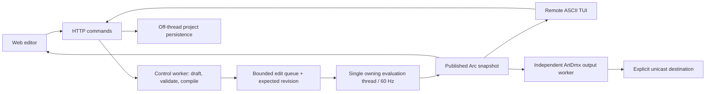

# Runtime and editing contract

`src/model.rs` defines authored programs, fixtures, content, channels and immutable-by-publication snapshot records. `src/scenic.rs` validates/imports/exports ScenicScript and describes the native/extension catalogue. `src/engine.rs` owns model edits, history, stateful node instances and evaluation. `src/artnet.rs` separates fixture byte encoding/transport packets from evaluation. `src/server.rs` supplies the engine service and HTTP adapters; `src/project.rs` persists modular project parts. `src/session.rs` persists versioned local session/history checkpoints on a dedicated worker. `src/tui.rs` is a remote client and ASCII renderer. `web/` contains no evaluator.

Only the engine thread installs model changes. Clients send commands containing stable fixture/node IDs and the revision they edited. Validation and script compilation build a draft on a blocking control worker. The engine rejects stale revisions and commits prepared edits at a frame boundary. At most four queued commands are processed per iteration; the queue holds 64 messages. Snapshots are reference-counted and obtained under a short lock; clients cannot mutate engine-owned state by editing them. File writes and HTTP response serialization run outside evaluation.

Evaluation is scheduled at 60 Hz using monotonic elapsed time. A delayed update caps clock advancement at 250 ms. This is a soft real-time implementation, not a deadline guarantee. Output has its own 1–44 Hz cadence and consumes the latest published frame. Slow clients skip intermediate frames; the current web/TUI clients poll at roughly 10 Hz. Art-Net transport has no rendering or UI dependency.

Fixture layers evaluate in descending stored order. Lower layers receive nearest-first higher-layer banks. Each stack evaluates all ordered children before its parent. The parent consumes its previously driven property values, then driver evaluation supplies values for a subsequent update. Float drivers clamp/map 0–1; integer drivers round; boolean drivers use >0.5. Existing projects default to three layers. Fixtures and the Director now support1–32 independent layers; disabled stacks preserve their program/state and skip evaluation. Layer1 remains fixture output. Workspace layouts are browser preferences, separate from project data and engine undo.

Banks carry optional scalar Value, color spreads, Position and fixture-reference channels. Missing values are distinct from explicit zero. Merge overwrites matching channels in child order. Native arithmetic uses the first child's channel domain. Fixture references resolve by stable ID, then native-style name fallback. Position lookups follow native live-object order: earlier fixtures can expose current-update positions; later fixtures expose their previous evaluated position, falling back to current setup. Director programs execute after fixtures; deferred actions resolve on a separate command worker. Rotation, speed/duration, moving-head slots, audio and CPU textures have typed bank fields. See [catalog port](catalog-port.md).

## Undo, state and edits

Every successful authored change stores a project memento and its compiled script set. Batch commands and partial content application form one history entry. Failed drafts install nothing. History keeps up to 128 edits; a new edit clears redo. Save leaves history intact. Pause and blackout are transport controls outside history.

Ordinary edits retain node state only where the same fixture/layer/node ID still has an equal authored node definition. Structural/property changes reset affected definitions. Reapplying an identical authored project is a no-op; there is not yet a separate restart-instance command. Undo/redo restores authored state and resets runtime node state. It does not rewind clocks or physical outputs. History is server-global in this initial implementation, so concurrent operators share the same undo order.

Web stage drags are provisional client geometry until release, then commit one MoveFixture command. Dimming sliders commit on change/release. The ASCII scene arrow keys currently create one edit each. Future gesture transactions can group repeated key edits; the current implementation does not claim general collaborative undo or branch-specific history.

## Scene and outputs

Fixtures have stable IDs, human-readable names, XYZ in metres, groups, model, universe, 1-based address and a 0–1 dimmer. Scene edits become visible to native spatial effects at subsequent evaluation. Routing collisions and footprints outside 512 slots are rejected. Fixture dimming/alpha and blackout are applied during byte encoding; RGBW uses a minimum-RGB white extraction policy.

ArtDmx fields follow the [official Art-Net specification](https://art-net.org.uk/downloads/art-net.pdf): opcode little-endian, protocol revision 14, 15-bit port address, big-endian even payload length, sequenced packets. The output worker sends full 512-slot universes to the configured unicast target. This is manual-target ArtDmx transmission, not a complete Art-Net discovery/controller implementation: ArtPoll subscriptions, RDM, ArtSync and device discovery are not implemented. The UDP source port is OS-assigned.

Disabling output stops future worker sends after it observes the updated frame. Blackout sends zeroed current universes while output remains enabled. Process shutdown stops sending; there is no guaranteed final blackout, stale-frame watchdog or receiver acknowledgment. Those policies should be added before relying on unattended physical operation. Loopback tests establish transport bytes, not device conformance.

## Scripting

Script.Value compiles Rhai before installation and executes with scalar input, monotonic t, fixture x/y/z, index and count. Native code handles routine maps, dimming, spatial functions and color operations. Scripts have no registered filesystem/network host functions, no module imports or eval; each invocation has 2,000 operations, 16 call levels, bounded expression depth, 4 KiB strings and 128-element arrays. Errors produce an empty bank plus a diagnostic. Execution is bounded but remains part of the frame budget. This is an extension boundary for trusted project authors, not a hardened multi-tenant sandbox.

## Persistence and next boundaries

Native gamma XML is not loaded. Layout JSON has version 1; content JSON currently contains an unversioned entry array. Reusable programs are ScenicScript YAML. A versioned content envelope/migration layer remains future work. Source project organization is preserved. Output is always disarmed after loading from disk, even when saved enabled. Content application validates the full batch before mutation; unknown fixture IDs are rejected. Group-restricted loads filter the content entries to current matching fixtures. Names supplied to save/load endpoints cannot traverse directories.

Remaining boundaries include a generalized plugin ABI, compiled dataflow plans, revision journals, native device/GPU output, production profiling and exact vvvv dependency parity. All 178 documented keys now dispatch to Rust implementations; numerical and integration coverage does not establish original-runtime conformance.

Development reloads can use `serve --resume-state PATH` with a trusted local `/api/state` publication. This restores authored state, clock, revision, pause/blackout and reconstructs native driver/hold/integrator state from telemetry. It is not a durable checkpoint format or general native-resource migration mechanism. Volatile undo/redo history cannot be recovered from an older server publication and starts empty.

Session checkpoints now preserve current authored state, bounded undo/redo and native runtime values across restart. Automatic recovery starts with output disarmed; explicit `--resume-session` preserves its intentional output settings. This is distinct from legacy `--resume-state`, which still cannot recover history. See [session history](session-history.md) for persistence windows, validation and recovery controls.
