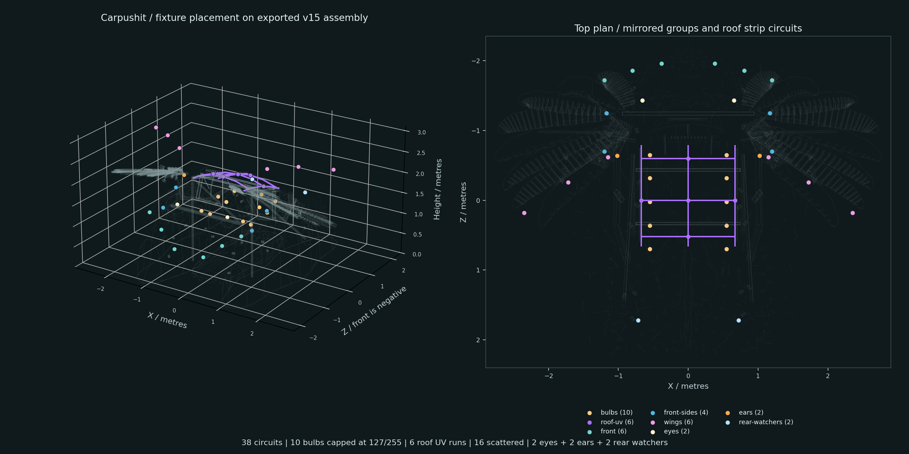

# Carpushit lighting scene

A loadable, output-disabled Schéma project based on the assembly recovered from **Design oscillating 4W light assembly**, chat `01a0bfc8-5889-7ca3-ae12-b162769fb299` (Codex/local, Carpushit project). Its optics simulator references the actual exported `Carpushit_lighting_v15.blend` assembly. The source model and original lighting study were read only; no live Blender, Windows Studio, Pi or hardware output was changed.

Scene: [complete API project](../../examples/scene-lab/carpushit/carpushit.project.json) · [portable folder](../../examples/scene-lab/carpushit/README.md) · [fixture patch](../../examples/scene-lab/carpushit/fixture-patch.csv) · [preset catalog](../../examples/scene-lab/carpushit/preset-catalog.json).



## Layout and explicit assumptions

The source is in Blender metres, Z up. Schéma uses `[X,height,Z] = [Blender X,Blender Z,Blender Y]`; front is negative Schéma Z. The exported assembly bounds are about5.55m across the wings,4.49m long and2.66m high. Those are the modeled dimensions, not a new measurement of the physical sculpture. Source reference hashes and roof strip paths are in [assembly-reference.json](../../examples/scene-lab/carpushit/assets/assembly-reference.json).

The user's scattered-light notation is provisionally interpreted as **3 front +2 front-side +3 above-wing lights on each side**, mirrored:16 scattered fixtures. A clarification was requested; literal grids mirrored per side would require a different count. Lamp positions are newly authored to the requested five-per-side arrangement, not copied from the old pendant study's two crosswise rows.

| Circuit family | Count | Position / group intent |
|---|---:|---|
| Bulbs |10|Five at X ±0.55m per side, longitudinal Z -0.65..0.70m, varied height1.15..1.45m. Groups `bulbs`, `bulbs-left`, `bulbs-right`, `interior`. |
| Roof UV |6|Two side rails, central spine and three cross runs. Paths follow the actual exported roof surface. One non-addressable dimmer circuit per run is a provisional control assumption. Group `roof-uv`, `interior`. |
| Front scattered |6|Three mirrored pairs ahead of the eye end. Group `front`, `outside`. |
| Front sides |4|Two mirrored pairs. Group `front-sides`, `outside`. |
| Above wings |6|Three mirrored pairs, authored at2.70..2.78m height. Mounting height is a proposed placement, not established structural support. Group `wings`, `outside`. |
| Eye headlights |2|At the exported eye-reflector centers. Group `eyes`, `outside`. |
| Ear blinkers |2|Near lateral roof supports. Group `ears`, `outside`. |
| Rear watchers |2|Opposite the eye end. Group `rear-watchers`, `outside`. |

All circuits belong to `all`; mirrored ones also have `left`/`right` and pair groups. Stable IDs and exact XYZ are in the project and CSV. Initial software patch is universe0, addresses1..38, one intensity slot per circuit. It is an authored simulation/control patch, not verified hardware addressing or wiring. Sixteen inside circuits (bulbs+UV) are isolated from the22 outside circuits.

Bulbs use project DMX model `bulb-half`, whose Value slot has maximum127. Thus FULL outputs **127/255** for all ten bulbs, and every other preset remains below that fixed ceiling without relying on a preset's scalar. Other circuits use a provisional single intensity channel, maximum255. This does not claim50% electrical power or measured photometry. Raw stage color is illustrative; captured DMX bytes reflect the model ceiling.

## Presets and independent control

All effects use native engine nodes: no Script.Value, expression scripts, plugins or external media. Primary presets write **API layer1 / UI Layer2 only**. They preserve the output compositor on API0 and optional twinkle on API2.

| Stored content ID | Effect | Scope / layers |
|---|---|---|
| `carpushit-full` |Steady100%; bulb model still caps at127.|All38 IDs, API1.|
| `carpushit-slow-pulse` |10-second sine,10..100%.|All38 IDs, API1.|
| `carpushit-alternate` |12-second left/right opposed sine,8..100%; center circuits follow the left phase.|All38 IDs, API1.|
| `carpushit-chase` |14-second cosine stripe sliding front to rear; floor4%, narrow crest up to100%, longitudinal wrap.|All38 IDs, API1.|
| `carpushit-twinkle` |Faint outside-only twinkle: outside primary becomes zero, independent seeded overlay varies1.2..7.5%.|Outside22 IDs, API1+2. Interior untouched.|
| `carpushit-twinkle-on` |Enables only the independent overlay, retaining current primary programs.|Outside22 IDs, API2.|
| `carpushit-twinkle-off` |Clears only the overlay, retaining primary programs.|Outside22 IDs, API2.|
| `carpushit-ears-blink` |1.5-second on/off cycle,50% duty.|Ear2 IDs, API1.|

Primary and twinkle values add and clamp0..1 in the permanent output compositor. Overlay remains authored while FULL is active, but its brightness change saturates at FULL; the `twinkle` preset explicitly sets outside primary zero so its faint effect is visible. The twinkle tree has a Constant multiplier1 for its master: adjust0..1 in UI Layer3 to scale it, or recall on/off. Random interval3.2s, filter2.4s, bounded jitter and explicit per-fixture seeds keep the effect slow and reproducible after a fresh runtime. It is not a strobe. Ordinary preset imports retain generator state according to the engine; whole project loads reset runtime.

Output composition retains scalar intensity for DMX and applies the same intensity through a separate numeric driver to its preview color. The existing owner-before-driver policy introduces one frame of preview-color delay. Bulb warmth, violet UV and other colors are preview cues; the provisional single-channel patch does not imply RGB control or spectral fluorescence.

## Load and recall now

Copy the **whole registry folder**, including all named `registry/content/carpushit-*.json` files, into a new scratch workspace. Named project saves alone are not a portable library of those content files.

```powershell
cd C:/Users/magne/dev/schema-rs
$destination = 'target/scene-lab/carpushit-review'
New-Item -ItemType Directory -Path $destination
Copy-Item examples/scene-lab/carpushit/registry "$destination/registry" -Recurse
Copy-Item target/debug/schema-rs.exe "$destination/schema-carpushit.exe"
& "$destination/schema-carpushit.exe" serve --project $destination --bind 127.0.0.1:18797
```

Use a new destination and free loopback port. The lab's existing review engine at18797 may already be running. Run the copied binary, not Cargo's locked build output. Startup keeps output disabled. Open `/` for Studio or `/mobile` for schémaboy. The current lab also has named saved project `carpushit-scene` in `target/scene-lab/carpushit`.

In Studio, **Apply to… → Load saved content**, enter `carpushit-slow-pulse` and optional group `bulbs-left`, then **Load content snapshot**. The actual UI interaction was verified to change exactly five left bulbs, and Undo restored FULL. The current main group target selector above these fields applies the selected program; it is separate from stored-content loading. The stored-content field itself is currently free text.

Equivalent verified API recall on an isolated engine:

```powershell
$base = 'http://127.0.0.1:18797'
$state = Invoke-RestMethod "$base/api/state"
$body = @{name='carpushit-slow-pulse';group='bulbs-left';expected_revision=$state.snapshot.revision} | ConvertTo-Json
Invoke-RestMethod "$base/api/content/load" -Method Post -ContentType application/json -Body $body
```

Use `group=$null` for all entries in a preset; use `outside`, `roof-uv`, `eyes`, `ears`, `wings`, `bulbs-right`, etc. to restrict. Group loading intersects a preset's stable fixture IDs: it does not retarget graphs to unrelated fixtures or invent entries. Twinkle has no authored bulb/UV entries. Loading a sparse content preset does not alter layout, fixture patch, DMX models or unmentioned layers.

## Native timed recall that works today

The Director UI Layer1 contains a native `Filter.Manual` around seven `Assign.Content` branches. Its **Open starts false**; it cannot change presets until explicitly opened. Comparison/LFO driver trees gate each assignment. The [cue sheet](../../examples/scene-lab/carpushit/assets/cue-sheet.json) is documentation metadata, not a new engine Project field.

| Engine seconds modulo120 | Recall | Group | Fade seconds |
|---|---|---|---:|
|0..24|FULL and twinkle-off|all / outside|0.8|
|24..48|Slow pulse|all|1.2|
|48..72|Alternation|all|1.2|
|72..96|Sliding chase|all|0.8|
|96..120|Faint twinkle + slow bulbs|outside / bulbs|1.0|

At the last cue, roof UV retains the previous chase program. The next loop restores FULL and clears the overlay. Enable through **Director → Layer1 → Manual gate → Open**; disable the same control for manual operation. Enabling joins the current global engine-clock phase; it does not start at zero. Engine Pause freezes phase. This is a verified native looping sequence, not a wall-clock/daylight schedule and not an editable timeline interface. Manual recalls while it is armed can be overwritten by the active cue; disarm first. Each effective recall enters shared undo history. A competing edit can return409; refresh revision and retry rather than bypassing authored validation.

A six-second/zero-fade cloned probe covered all five windows in70 checked frames. It preserved all fixture patch and output compositor trees. A separate actual0.8-second native group fade showed Transition.Fade and its completed adoption, while the opposite bulb group remained FULL. The source120-second version was restored disarmed afterward. No seek/restart timeline transport is claimed.

## Selector and timeline editor: pending implementation

The human requested a discoverable stored-content selector and group/cue timeline controls. The implementation chat confirmed they do **not** currently exist. It is handling an active UI correction and now a generic GPU scene-preview request, so it cannot implement that larger feature in this batch. The lab requested it explicitly, supplied stable preset IDs and sparse layer/cue contracts, and did not change source code. Existing free-text recall and native Director are usable now; they are not represented as the requested new selector/editor. Track [SL-004](findings.md#sl-004--carpushit-preset-library-selector-and-cue-timeline-editor).

## Frozen 3D preview bundle

`assets/carpushit-preview.glb` is actual simplified assembly geometry: **58,533 triangles,4,560,244 bytes, six mesh/material roles**. SHA256 `26724b97b48a81d3530f22d80b13e5a873f8eb263be4a28ba76f787a91143b48`. It is already in Schéma metres/Y-up/front-Z, with no root transforms, recentering or rescaling required. Source axes were reflected with winding correction before standard glTF conversion. Exact finite bounds, source hashes, exclusions and private-use rights are in [preview-bundle.json](../../examples/scene-lab/carpushit/assets/preview-bundle.json).

Original ground, old CAD lamp/rope/cable fixtures and light-study housings were excluded to avoid duplicating the new placement. Plain PBR role materials approximate the source palette; procedural textiles, painted ornament and optics were not transferred. This is a static preview LOD, not mechanical CAD, physical optics or a faithful material/lighting simulation. No source `.blend` was saved or replaced.

[preview-lights.json](../../examples/scene-lab/carpushit/assets/preview-lights.json) gives all38 stable source roles, colors, approximate directions/targets/ranges and roof-line sample paths. Directions are authored visualization assumptions. Intensity binds to the captured DMX slot byte divided by255, preserving bulb ceiling, master gain and blackout. [reference-full.json](../../examples/scene-lab/carpushit/assets/reference-full.json) provides a static read-only FULL reference. Choosing that preview must not load a project or send commands; live mode must read published engine snapshots and never evaluate the graph in the browser. The GPU preview implementation belongs to the implementation chat and is pending, not a feature provided by these data files.

The current authorization covers local/private preset bundling. These user-provided assets are not relicensed by the app's MIT code license; no public publication is assumed. Files are frozen for implementation to copy; a later human count/placement correction will require an explicit bundle revision.

## Evidence

- [Scene validation](evidence/carpushit/scene-validation.json): exact named save/load; all four primary effects checked against native formulas across152 fixture comparisons; group isolation5 changed/33 untouched; twinkle22 outside/16 interior untouched;12 slow-twinkle sampled frames remain1.2..7.5%.
- [Native recall](evidence/carpushit/native-cue-validation.json), [group fade](evidence/carpushit/native-fade-validation.json), [UI group recall](evidence/carpushit/ui-group-recall.json).
- Eight standalone ScenicScript examples validated with the copied executable. Their layer/reference dependencies remain as documented above.
- [Fresh GLB import metrics](evidence/carpushit/geometry-import-metrics.json):58,533 triangles, finite vertices, no degenerate faces, zero-length edges or missing material faces. Six-view [contact sheet](evidence/carpushit/geometry-views/contact_sheet.png) and hero inspected. Independent import/export validated unchanged and produced a byte-identical GLB. Many split flat-normal triangle boundaries are expected for this rendered preview; watertight printing/collision is not claimed.
- Source HEAD at engine copy8dbdbc49de76, existing copied executable SHA256 `e7b05c8f2f86c4c9b10e153a6d2f62d86891ce015a1debc349ee6ff75f415e06`. Later UI releases were announced separately; no new engine semantics were assumed. No application source/tests/scripts/dependencies/deployment changes or commits by the lab.
